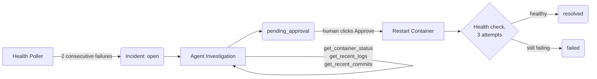

# AI SRE

An incident-response agent that investigates its own evidence, explains its reasoning, and never acts without a human approving the specific action first.


## What this is

A health poller watches a service. When it fails, an LLM agent gathers evidence using three tools — container status, recent logs, recent commits — and produces a structured root-cause analysis with a confidence score and a recommended action. A human reads that analysis and approves it. Only then does the system restart the service, and only then does it re-check health before calling the incident resolved.

The point isn't the restart — `docker restart` is one line. The point is everything around it: an agent that has to justify its conclusion with evidence, a system that never lets it act unsupervised, and a state machine that verifies its own work instead of assuming success.

**Live:** https://sre.rajpatil.dev/dashboard/ — break it yourself:
```bash
curl -X POST https://sre.rajpatil.dev/demo/trigger-incident
```
Refresh the dashboard and watch it investigate, reach a verdict, and wait for approval — live, not a recording.

## How it works



Every arrow into a parenthesized state is a real status in the database, not a UI label — the dashboard reads directly off this state machine, nothing is simulated client-side.


## Design decisions worth asking about

**Why a toy victim service instead of a real dependency.** The point of a test fixture is to fail in ways you already understand. A real Redis or Postgres dependency would add a second system whose failure modes could be confused with the agent's own bugs. `victim-app` is one in-memory boolean flag, flippable on command — deterministic, and restarting the container genuinely fixes it, because a fresh process resets the flag to its code default. That's not a shortcut; it's a faithful, simplified model of why "turn it off and on again" actually works on real transient bugs.

**Why exactly three tools, not more.** Every tool added multiplies the reasoning space an agent has to search, and tool bloat is a real, current problem in production agent systems — large tool counts mean slower, more expensive, harder-to-debug investigations before the model has done anything useful. Three tools is enough to explore the useful combinations in 2-4 calls.

**Why the agent can't just say "trust me."** A system prompt asking for at least two tool calls is a request; a model can ignore it or convince itself one was enough. `executed_tool_count` is tracked in Python and checked before any conclusion is accepted, independent of what the model claims. Prompting is a suggestion. A counter is a fact.

**Why the RCA is structured JSON, not prose.** Prose can't be reliably parsed, displayed consistently, or graded against a test scenario. The schema (`root_cause`, `confidence`, `evidence`, `recommended_action`, `risk`) is enforced at the API boundary, with one retry if the model wraps its answer in markdown fences despite being told not to — a real failure mode, not a hypothetical one.

**Why the human approves a fixed action, never the model's free text.** `recommended_action` is displayed for context. It is never executed. Approval always runs the same predetermined action — a container restart — regardless of what the agent's text suggests. This turned out to matter in practice, not just in theory:

> On one real run, the agent's RCA confidently cited "exit code 137 (OOM kill)" and "3 restarts" — neither of which appeared anywhere in the tool output it had actually received, which showed `exit_code: 0`, `restart_count: 0`. A plausible-sounding hallucination, built on real but insufficient evidence. Because approval never executes the model's own suggested action, the blast radius of that hallucination was a wrong *explanation*, not a wrong *action*. The next run, same code, produced an accurate RCA — this is a model-quality problem, not a pipeline bug, and it's the strongest real argument for the design choice above.

**Why verification happens after remediation, not just a status flip.** The system re-checks health up to three times after the restart before calling anything resolved. If it's still unhealthy, the incident is marked `failed`, not `resolved` — the system never self-reports success without checking.

**Why the approval endpoint checks status before scheduling the background task, not inside it.** FastAPI's background tasks run after the HTTP response is already sent. A guard living only inside the remediation function would return "approval received" to an invalid request (wrong status, already resolved) and the real rejection would only ever surface in a server log. The check happens synchronously in the endpoint itself, so an invalid approval gets a real `409`, immediately.


## Stack

- **Agent** — NVIDIA NIM (`nvidia/nemotron-3-ultra-550b-a55b`) via an OpenAI-compatible tool-calling API
- **Backend** — FastAPI, SQLAlchemy, SQLite
- **Target service** — a minimal FastAPI app in a Docker container, chaos-testable via two admin endpoints
- **Dashboard** — vanilla JS, no framework, no build step, no CDN dependency — every asset including fonts is self-hosted so the demo doesn't depend on a third party's uptime
- **Infra** — AWS EC2, Caddy (automatic HTTPS via Let's Encrypt), systemd

## Running it locally

```bash
# 1. the target service
cd victim-app
docker build -t victim-app .
docker run -d -p 8000:8000 --name victim-app victim-app

# 2. the backend (poller, agent, dashboard)
cd ../backend
python3 -m venv venv && source venv/bin/activate
pip install -r requirements.txt
export NVIDIA_API_KEY=your-key-here
uvicorn main:app --reload --port 9000

# 3. break it and watch
curl -X POST localhost:8000/admin/break
# open http://localhost:9000/dashboard/
```

## What's next

Two extensions are designed but deliberately not built yet, because bolting them onto a system that hadn't shipped a working core loop would have been the same mistake twice:

- **[Atlas](https://github.com/Raj-glitch-max/atlas)-gated remediation** — before the restart executes, the orchestrator would need to hold a valid, unexpired, cryptographically verifiable capability scoped to that exact action, not just a human's approval as a process step. This turns "the model wants to restart the container" and "the model is authorized to restart the container" into two separately-enforced facts.
- **[KLRB](https://github.com/Raj-glitch-max/kubernetes-llm-incident-response-benchmark)-style faithfulness evaluation** — the hallucination above was caught by manually comparing the RCA against the raw tool output. A proper evaluation harness would check this automatically, scoring whether an RCA's claimed evidence actually appears in the evidence the agent received.

---

Built by [Raj Patil](https://rajpatil.dev).
